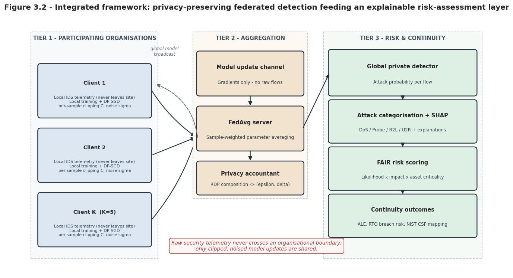
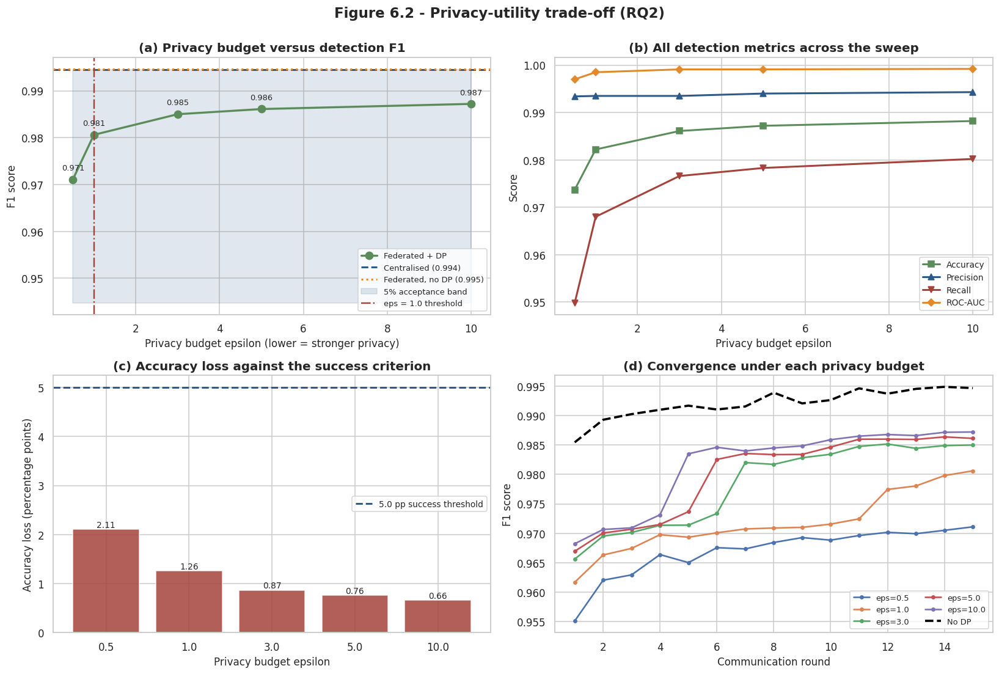
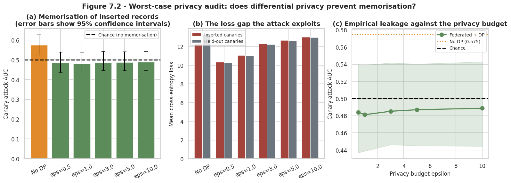
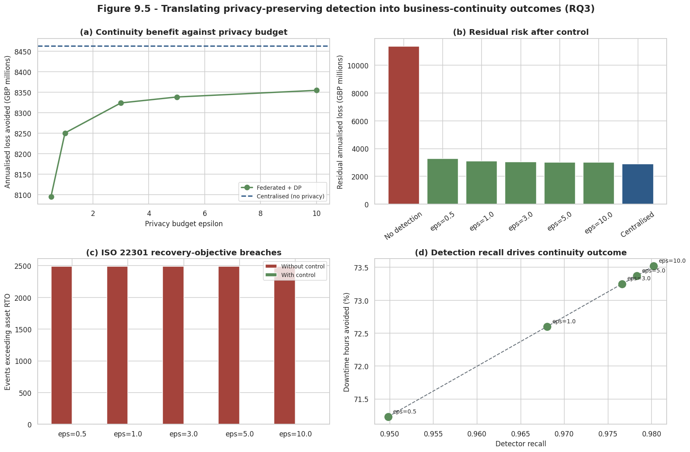

# Privacy-Preserving Federated Intrusion Detection, from Privacy Budget to Business Impact

Organisations want shared intrusion detection, but they cannot hand raw network traffic to each other. This project tests whether a detector can be **trained collaboratively, carry a formal privacy guarantee, and still be accurate enough to support continuity decisions**, and it measures what each of those three steps costs.



## Key results

| Question | Finding |
|---|---|
| What does federation cost? | Almost nothing. Federated **F1 0.9947** vs centralised **0.9944** (3 seeds, p = 0.335, not significant). |
| What does differential privacy cost? | At **ε = 1.0**, accuracy is **1.26 points** below the centralised baseline. Tightening from ε = 10 to ε = 1 costs about 0.6 further points. |
| Does the privacy actually help? | A canary membership-inference audit separates inserted records at AUC **0.575** without noise. With DP at every budget tested, the attacker is pushed back to chance. |
| Is it practical? | Training moves **14.6 MB** of model updates instead of **48.8 MB** of raw traffic. |
| Does it matter operationally? | In a modelled risk layer, the private detector avoids **71%** of expected downtime hours and cuts recovery-objective breaches from **2,488 to 1**. |

## Approach

The framework has three tiers, and the privacy guarantee is enforced before anything leaves a participant:

1. **Participants.** Five simulated organisations with deliberately uneven, non-identical data (Dirichlet α = 0.5, client sizes from 1,280 to 64,585 records, attack rates from 37% to 80%).
2. **Private training.** Federated averaging over 15 rounds. Each client trains a small MLP (24,386 parameters) with **DP-SGD**: per-example gradient clipping at 1.0 and Gaussian noise calibrated **per client** to a target ε and a client-specific δ, using Rényi accounting. Budgets swept: ε = 0.5, 1, 3, 5, 10.
3. **Decision layer.** SHAP explanations of each alert, then a FAIR-style risk score and a business-continuity estimate (downtime, recovery-time objectives).

Federation and noise are added one at a time, so the cost of each can be read separately.



## Evidence behind the numbers

- **Replication.** The design was run on NSL-KDD (main benchmark) and repeated on UNSW-NB15. The shape of the privacy-utility curve carries over.
- **Privacy audit.** Beyond the formal ε, inserted "canary" records were used to measure real memorisation (worst-case audit). The result supports the DP training, with the caveat that an audit shows attacks that were tried, not a proof.
- **Ablations.** FedAvg vs FedProx, number of clients, and degree of heterogeneity.
- **Explainability.** SHAP attributions for the DoS class point to SYN-flood signals such as connection-flag and host-error-rate features, which matches how the attack works.



## Limitations

- **Official test split is much harder.** On NSL-KDD's official test file, which contains attacks unseen in training, the centralised model scores F1 about **0.77**. The 0.99 figures use the internal held-out split. The notebook reports both.
- **NSL-KDD is old** (late-1990s traffic), so results are weak evidence about modern networks.
- **Clients are simulated.** Real organisations also differ in schema, sensors and labelling.
- **Active attackers are out of scope** (poisoning, malicious participants, server collusion). DP does not defend against them.
- **The business figures are modelled.** Asset values, outage costs and recovery objectives are stated assumptions. The relative comparison between configurations is meaningful, and the absolute currency values are not forecasts.
- **Rare classes** (e.g. user-to-root, 10 test records) are statistically thin.



## Repository map

```
notebooks/   federated_dp_ids_end_to_end.ipynb: data, baseline, federated, DP, audit, risk layer (outputs kept)
results/     figures/ used in this README, plus the evaluation dashboard
```

The notebook was run on Google Colab with a T4 GPU. It downloads NSL-KDD and UNSW-NB15 from public mirrors, and writes outputs to a timestamped folder on a mounted Drive. Please check each dataset's terms before reuse. No datasets are stored here.

## License

MIT for the code in this repository.
